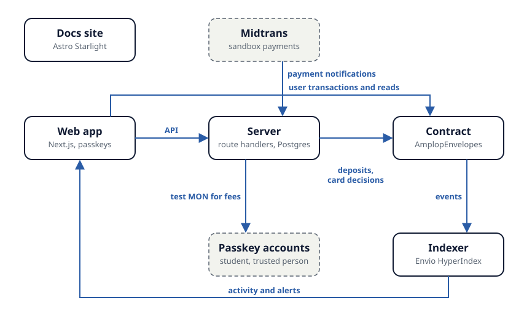

# Amplop

Amplop is an allowance wallet for Indonesian students studying far from home. A parent pays rupiah once; the money arrives as digital dollars (AUSD on Monad testnet), splits into five envelopes, and is released one weekly share at a time. A card pays from the envelope that matches the kind of shop, and the Emergency envelope opens when a trusted person approves, or by itself after 48 hours.

## Live links

| What         | Where                                                                                                                  |
| ------------ | ---------------------------------------------------------------------------------------------------------------------- |
| App          | Set from `NEXT_PUBLIC_SITE_URL` at the first production deploy                                                         |
| Docs         | Set from `NEXT_PUBLIC_DOCS_URL` at the first production deploy ([source](apps/docs/src/content/docs/))                 |
| Try-it guide | Docs page "Try it" ([source](apps/docs/src/content/docs/try-it.mdx))                                                   |
| Demo video   | Added at submission                                                                                                    |
| Pitch video  | Added at submission                                                                                                    |
| Contract     | [`AmplopEnvelopes` on MonadVision](https://testnet.monadvision.com/address/0x5596Bf1014EC25F760e8976f1DD8a40Ee250c56C) |

## What is new

1. Money split into envelopes on arrival.
2. Weekly release.
3. The contract itself deciding each card payment.
4. A trusted person who can open Emergency but cannot block it.
5. A parent who sees totals, not shops.

## Design principle

<!-- principle:crypto-free -->

> **No new vocabulary.** Parents and students should not need new words to send or spend an allowance. So sign-in is a passkey, with no recovery phrase. The user never sees or pays a network fee. There is no wallet prompt. The token's name appears only in the small detail panel beside a transaction proof.

## What is real, simulated, and not built

<!-- fragment:real-simulated:start -->

| Piece                                                    | State                 | Detail                                                                                          |
| -------------------------------------------------------- | --------------------- | ----------------------------------------------------------------------------------------------- |
| Envelope rules (split, weekly release, locks, limits)    | Real                  | A contract on Monad testnet holds the AUSD and enforces every rule.                             |
| Card decision (approve, decline, which envelope)         | Real                  | Decided by the contract in one transaction. The server cannot spend locked or unreleased money. |
| Trusted-person approval                                  | Real                  | A second passkey account signs a transaction.                                                   |
| Passkey accounts                                         | Real                  | Mera derives a normal account from the passkey. No password, no seed phrase.                    |
| AUSD                                                     | Real testnet token    | From the Agora faucet: 10.000 AUSD per request, once a minute.                                  |
| Rupiah payment                                           | Simulated             | Midtrans sandbox. No real rupiah moves.                                                         |
| Rupiah to dollar conversion                              | Simulated             | A treasury wallet holds test AUSD and pays out at a fixed sample rate.                          |
| Card and shop                                            | Simulated             | A checkout screen stands in for the shop's card machine. No card network.                       |
| Alerts to the parent                                     | In-app only           | Shown when the parent opens the app. No push notification.                                      |
| Time                                                     | Skippable in the demo | See section 12. Real values are 7 days and 48 hours.                                            |
| Real card issuer, real rupiah, identity checks, cash-out | Not built             | Listed in section 18.                                                                           |

<!-- fragment:real-simulated:end -->

Section 12 is the demo controls, described on the docs page [Try it](apps/docs/src/content/docs/try-it.mdx); section 18 is the [Roadmap](apps/docs/src/content/docs/roadmap.mdx).

## Time in the demo

<!-- fragment:demo-time:start -->

Real values are 7 days between shares, 48 hours for every wait, 7 days for a hold; the demo deployment keeps those values and adds a skip.

<!-- fragment:demo-time:end -->

The demo deployment has four controls: Simulate payment, View as Mama / View as Raka, Skip time and Collect now. None of them exist in a real deployment: their server routes answer "not found" and the contract refuses to skip.

## Contract addresses

Monad testnet, chain 10143. From [`deployments/monad-testnet.json`](deployments/monad-testnet.json).

| Name                | Address                                                                                                                            | Notes                                                                                                   |
| ------------------- | ---------------------------------------------------------------------------------------------------------------------------------- | ------------------------------------------------------------------------------------------------------- |
| `AmplopEnvelopes`   | [`0x5596Bf1014EC25F760e8976f1DD8a40Ee250c56C`](https://testnet.monadvision.com/address/0x5596Bf1014EC25F760e8976f1DD8a40Ee250c56C) | Source verified on Sourcify; deploy block 70137747; deploy commit `43b7c5c`                             |
| AUSD (testnet)      | [`0xa9012a055bd4e0eDfF8Ce09f960291C09D5322dC`](https://testnet.monadvision.com/address/0xa9012a055bd4e0eDfF8Ce09f960291C09D5322dC) | 6 decimals, read by `decimals()` at deploy; from the [Agora docs](https://docs.agora.finance/developer) |
| Settlement wallet   | `0xc22A14fB5166A595B887EeA1A8744A1Ec1B5A28F`                                                                                       | Receives collected card payments                                                                        |
| Treasury wallet     | `0xAA56c1D96160D3d290204C1B156B857CAa198bc5`                                                                                       | Deposits allowances                                                                                     |
| Card service wallet | `0x4C1ce63Dfa4036970CC26B0d9caFcF6821EB2eB6`                                                                                       | Asks for card decisions                                                                                 |
| Fee sponsor wallet  | `0x1b074eFDDbdB5E75368340a1dbb23f9535cC3D93`                                                                                       | Sends test MON for fees                                                                                 |

## Architecture and tech stack

| Piece     | Built with                                                      | Job                                                                                                  |
| --------- | --------------------------------------------------------------- | ---------------------------------------------------------------------------------------------------- |
| Web app   | Next.js 16, Tailwind v4, shadcn/ui, viem, `@category-labs/mera` | Landing page and the phone app. Signs the user's own transactions with their passkey account.        |
| Server    | Next.js route handlers on Vercel, a small Postgres database     | Fee top-up, rupiah payments, the card service, server-held text (shop names, reasons, invite names). |
| Contract  | Solidity, Foundry, deployed on Monad testnet (chain 10143)      | Holds AUSD. Splits, releases, approves or declines purchases, runs every 48-hour wait.               |
| Indexer   | Envio HyperIndex                                                | Turns contract events into the activity list and the parent's alerts.                                |
| Docs site | Astro Starlight                                                 | Architecture, contract and API reference, trust and security, try-it guide.                          |

- **Three server keys.** Treasury can only deposit into an account; Card service can only ask the contract to approve, collect, release or refund a purchase; Fee sponsor only sends test MON for fees. None can touch locked or unreleased money.
- **Fees.** Sponsored in this version through a small top-up; a relayer replaces the top-up for a real launch.
- **Indexer.** Not needed for balances, totals, the release schedule, Emergency or card results; those come from the contract.

More on the docs page [Architecture](apps/docs/src/content/docs/architecture.mdx).

## What the chain shows

<!-- fragment:r27:start -->

Shop names are kept on the server and shown only to the student. The chain records the envelope, the amount, the time and the kind of shop. Anyone who looks up the contract can see those. The same data is served by the public indexer.

<!-- fragment:r27:end -->

In the app, the parent sees totals, not shops.

## Repository layout

| Folder            | What                                                                 |
| ----------------- | -------------------------------------------------------------------- |
| `apps/web`        | The Next.js app: landing page, phone app and server API              |
| `apps/docs`       | The docs site (Astro Starlight)                                      |
| `contracts`       | The `AmplopEnvelopes` contract, its Foundry tests and deploy scripts |
| `indexer`         | The Envio indexer ([write-up](indexer/README.md))                    |
| `packages/shared` | ABI, enums, money and date maths shared by the app and server        |
| `audits`          | The self-review report and accepted analysis findings                |
| `deployments`     | Deployment records per network                                       |

## Set-up

1. Install Node 24 (version in `.nvmrc`), Foundry (version in `tools/versions.env`), Docker, gitleaks, and pnpm (for the indexer; version in `tools/versions.env`).
2. Clone, then `npm ci` (this also installs the git hooks).
3. `cp .env.example apps/web/.env.local`.
4. Start Postgres and run migrations: `npm run db:up`, then `npm run db:migrate`.
5. Start Anvil and deploy the contract in demo mode with the stand-in AUSD: `npm run chain:up` in one terminal, then `npm run deploy:local`; it writes `deployments/anvil.json`.
6. Start the indexer against Anvil: in `indexer/`, `pnpm install`, `pnpm codegen`, `pnpm e2e:config`, then `pnpm exec envio dev --config config.e2e.yaml`.
7. Start the app: `npm run dev -w apps/web`; open `http://localhost:3000`.
8. Optional: the docs site with `npm run dev -w apps/docs`.
9. Optional: install the pinned AI skills with `scripts/install-ai-skills.sh`.

## Tests

| Command                      | Runs                                                   |
| ---------------------------- | ------------------------------------------------------ |
| `npm run test`               | Unit and server tests (Vitest)                         |
| `npm run test:coverage`      | Same, with the 85% floor on server logic               |
| `npm run test:contracts`     | Foundry tests, one per rule (R1 to R24)                |
| `npm run test:contracts:ci`  | Same, with fuzz at 10,000 runs and the invariant tests |
| `npm run coverage:contracts` | Contract coverage, floors 95% lines and 90% branches   |
| `npm run analyze:contracts`  | Slither and Aderyn                                     |
| `npm run test:e2e`           | Every automated end-to-end case on the local stack     |
| `npm run e2e:tier1:ci`       | The 40 Tier 1 end-to-end cases on a local chain        |
| `npm run gates`              | Every local gate in order                              |

There are 140 end-to-end cases in three tiers: 40 automated before recording, 65 automated or run by hand on Mon 12 Oct, and 35 by hand. The case map is in [`specs/19-e2e-harness.md`](specs/19-e2e-harness.md); hand-run results are in `apps/web/e2e/manual/`. The indexer has its own handler tests (`pnpm test` in `indexer/`).

## Security

The contract is self-reviewed, findings published: see the [self-review report](audits/2026-10-self-review.md) and [SECURITY.md](SECURITY.md). The gates in PRD 15 (types, lint, tests, contract analysis, code scanning, secrets, dependencies, build and bundle scan) run on every push, and production deploys only from green commits.

## AI tools used

- **Tools.** Claude Code (Anthropic) as the coding agent, running Claude Opus 5.5; Claude for drafting the PRD and the specs.
- **What for.** The specs, the application and contract code, the tests, the documentation, and the first pass of the self-review.
- **Pinned skills.** MONSKILLS at commit `3f8efd2` (plugin 0.7.2) and pashov/skills at commit `92b0ea6`, not updated during the freeze.
- **How the output was checked.** Every commit passed the same gates as hand-written code. An AI-reported finding counted only after a failing test proved it, or it was marked a false positive with a reason. The two-phone script was run by hand.
- **Responsibility.** The builder reviewed and is responsible for all code in this repository.

## Attribution

Amplop is built with, and thanks:

| Project                                                                                                                 | Licence               |
| ----------------------------------------------------------------------------------------------------------------------- | --------------------- |
| [Mera](https://www.npmjs.com/package/@category-labs/mera) (`@category-labs/mera`)                                       | MIT or Apache-2.0     |
| [AUSD](https://docs.agora.finance/developer) by Agora                                                                   | Testnet token         |
| [Envio HyperIndex](https://docs.envio.dev)                                                                              | GPL-3.0               |
| [Midtrans](https://docs.midtrans.com) sandbox                                                                           | Service terms         |
| [OpenZeppelin Contracts](https://github.com/OpenZeppelin/openzeppelin-contracts)                                        | MIT                   |
| [Foundry](https://github.com/foundry-rs/foundry)                                                                        | MIT or Apache-2.0     |
| [Next.js](https://github.com/vercel/next.js)                                                                            | MIT                   |
| [React](https://github.com/facebook/react)                                                                              | MIT                   |
| [Tailwind CSS](https://github.com/tailwindlabs/tailwindcss)                                                             | MIT                   |
| [shadcn/ui](https://github.com/shadcn-ui/ui)                                                                            | MIT                   |
| [viem](https://github.com/wevm/viem)                                                                                    | MIT                   |
| [wagmi CLI](https://github.com/wevm/wagmi)                                                                              | MIT                   |
| [Astro Starlight](https://github.com/withastro/starlight)                                                               | MIT                   |
| [Playwright](https://github.com/microsoft/playwright)                                                                   | Apache-2.0            |
| [Plus Jakarta Sans](https://github.com/tokotype/PlusJakartaSans) and [Archivo](https://github.com/Omnibus-Type/Archivo) | SIL Open Font License |
| [MONSKILLS](https://github.com/therealharpaljadeja/monskills)                                                           | MIT                   |
| [pashov/skills](https://github.com/pashov/skills)                                                                       | MIT                   |

## Licence

MIT. See [LICENSE](LICENSE).
